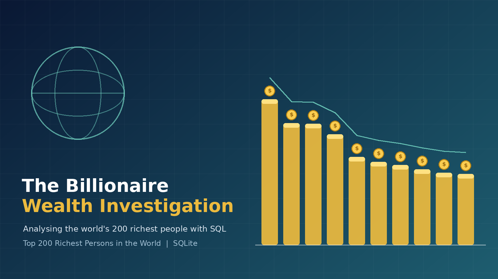

# BILLIONAIRE-WEALTH-INVESTIGATION-REPORT
## An SQL analysis of the world’s 200 richest people

### Prepared by: Clinton Quarshie
Tool: SQLite on sqliteonline.com   |   Dataset: Top 200 Richest Persons in the World (Forbes list)

## 1. Introduction
A global financial research organisation wants to understand how wealth is distributed among the 200 richest people in the world. In the role of a Junior Data Analyst, my task is to load the dataset into SQLite, ask a series of business questions, and answer each one with an SQL query.

This report documents that work. It describes the dataset and its columns, shows the SQLite workspace on sqliteonline.com, lists the fifteen business questions, and gives for each one the SQL code, a snapshot of the result and a short interpretation. Ten of the questions come from the project brief. Five more were taken from the FadaQa Tech Scholarship 2.0 practice list to go deeper into percentages, age groups and industry wealth.

The queries use core SQL: SELECT, WHERE, ORDER BY, LIMIT, GROUP BY, HAVING, aggregate functions (COUNT, SUM, AVG, MIN, MAX), CASE expressions and a subquery.

## 2. About the Dataset
The Top 200 Richest World’s Billionaires Dataset gives a detailed overview of the wealthiest individuals globally, according to the Forbes list. It captures each billionaire’s ranking, age, country, net worth and the industry from which the wealth mainly comes. It is useful for studying wealth distribution, industry dominance and the demographics of the world’s richest people.

### Dataset at a glance
	                                   
- Item: Records	 |  Detail: 200 billionaires, one row each
- Item: Columns  |  Detail: 7
- Item: Countries represented	 |  Detail: 35
- Item: Industries represented	|  Detail: 18
- Item: Age range	  |  Detail: 31 to 100 years
- Item: Combined net worth	|  Detail: $6,368.5 billion
- Item: Source  |  Detail: Forbes list of the world’s richest people (CSV file)

### Data quality note

While checking the data I found that two country values contained stray spaces (‘China ’ and ’ Brazil’). Without cleaning, SQL treats ‘China’ and ‘China ’ as two different countries and splits China’s count into 16 and 1. All country queries therefore use TRIM(country), which gives China its correct total of 17 billionaires

## 3. Column Descriptions

- **serial_number**: Sequential numbering of the billionaires in the dataset.
- **rank**: The global ranking of the billionaire based on their net worth as per the Forbes list.
- **name**: The name of the billionaire.
- **age**: The age of the billionaire.
- **country**: The name of the country to which they belong.
- **networth_billion_US_dollars**: The total net worth of the billionaire, expressed in billions of dollars.
- **industry**: The industry or sector to which the billionaire's wealth is primarily attributed.

## 4. The SQLite Workspace on sqliteonline.com
 

All queries were written and run in the SQLite environment on sqliteonline.com.

### Steps followed

1. Open sqliteonline.com and choose SQLite as the database.
2. Create the table named “Top 200 Richest Persons in the World” and load the 200 rows from the CSV file (the script below does both in one step).
3. Paste one query at a time into the editor.
4. Press the run button and read the output in the results grid.
5. Take a snapshot of the query and its result.

### Creating the table
CREATE TABLE "Top 200 Richest Persons in the World" (
  serial_number INTEGER,
  rank INTEGER,
  name TEXT,
  age INTEGER,
  country TEXT,
  networth_billion_US_dollars REAL,
  industry TEXT
);
-- followed by INSERT INTO ... VALUES (...) for the 200 rows

## 5. Business Questions
Questions 1 to 10 come from the project brief. Questions 11 to 15 were added from the practice list.

1. Retrieve the 20 richest billionaires.
2. Identify the five youngest billionaires.
3. Calculate the average age and average net worth.
4. Identify the five most represented countries.
5. Calculate the combined net worth of billionaires from each country.
6. Identify the five industries with the highest number of billionaires.
7. Find countries with at least five billionaires.
8. Calculate the total wealth of billionaires younger than 50.
9. Identify billionaires whose net worth exceeds the overall average net worth.
10. Identify the industry with the highest average net worth.
11. What percentage of the dataset is made up of billionaires younger than 50?
12. Which country has the highest number of billionaires below age 40?
13. Which industry contributes the most to the combined wealth of the top 200?
14. What is the difference between the richest and poorest billionaire in the dataset?
15. What is the average net worth of billionaires aged above 70?

## 6. Queries, Snapshots and Findings
Each question below shows the SQL code, a snapshot of the query and its result, and a short finding.
### Question 1: Retrieve the 20 richest billionaires.

Finding: Bernard Arnault & family (France) is the richest at $233B, ahead of Elon Musk ($195B) and Jeff Bezos ($194B). Jensen Huang closes the top 20 at $77B, and 14 of the 20 are from the United States.

### Question 2: Identify the five youngest billionaires.

Finding: The five youngest billionaires are all under 40. Mark Mateschitz (Austria) is the youngest at 31. Three of the five are from the United States, and Mark Zuckerberg is the richest of them at $177B.

### Question 3: Calculate the average age and average net worth.

Finding: The average billionaire is 69.38 years old and worth $31.84B.

### Question 4: Identify the five most represented countries.

Finding: The United States leads clearly with 79 billionaires, followed by China (17), India (13), and Russia and Germany (11 each). China’s count of 17 only appears correctly after TRIM removes the stray space.

### Question 5: Calculate the combined net worth of billionaires from each country.

Finding: The United States holds the largest combined wealth by far at $3,130.9B, followed by France ($478.8B), India ($434.5B), China ($387.4B) and Germany ($248.2B). Thirty-five countries are represented.

### Question 6: Identify the five industries with the highest number of billionaires.

Finding: Technology has the most billionaires (40), followed by Finance & Investments (32) and Fashion & Retail (30). Food & Beverage and Diversified tie on 15.

### Question 7: Find countries with at least five billionaires.

Finding: Eight countries have at least five billionaires: United States 79, China 17, India 13, Russia 11, Germany 11, Hong Kong 7, France 7 and Australia 5.

### Question 8: Calculate the total wealth of billionaires younger than 50

Finding: Billionaires younger than 50 hold $508.3B in combined wealth.

### Question 9: Identify billionaires whose net worth exceeds the overall average net worth.

Finding: 53 of the 200 billionaires are worth more than the $31.84B average, which shows that a small group of very large fortunes pulls the average up.

### Question 10: Identify the industry with the highest average net worth.

Finding: Telecom has the highest average ($102.0B), but it contains only one person (Carlos Slim Helu & family). Among industries with many billionaires, Technology leads with $43.47B across 40 people, followed by Fashion & Retail ($38.85B).

### Question 11: What percentage of the dataset is made up of billionaires younger than 50?

Finding: Billionaires under 50 make up 8% of the dataset, which is 16 of the 200 people.

### Question 12: Which country has the highest number of billionaires below age 40?

Finding: Only five billionaires are under 40, and the United States leads with 3 of them. The United Arab Emirates and Austria have 1 each.

### Question 13: Which industry contributes the most to the combined wealth of the top 200?

Finding: Technology contributes the most combined wealth at $1,738.8B (about 27% of the total), ahead of Fashion & Retail ($1,165.5B) and Finance & Investments ($852.6B).

### Question 14: What is the difference between the richest and poorest billionaire in the dataset?

Finding: The richest billionaire has $233.0B and the poorest on the list has $10.7B (Suleiman Kerimov & family), a gap of $222.3B.

### Question 15: What is the average net worth of billionaires aged above 70?

Finding: There are 102 billionaires above age 70 and their average net worth is $29.75B, slightly below the overall average of $31.84B.

## 8. Conclusion

The analysis shows that wealth among the world’s 200 richest people is highly concentrated, in three ways.

By country. The United States has 79 of the 200 billionaires and holds about $3,131 billion, close to half (49%) of the combined $6,368.5 billion. France, India and China follow far behind in total wealth, and eight countries have five or more billionaires.

By industry. Technology has the most billionaires (40) and contributes the most combined wealth ($1,738.8 billion, about 27%), followed by Fashion & Retail and Finance & Investments. Telecom has the highest average net worth only because it contains a single person, so Technology is the more meaningful leader on average.

By age and size. The typical billionaire in the list is older (average age 69.4) and worth about $31.8 billion, yet the average is pulled up by a few giants: only 53 people are above it. The richest person is worth $233 billion, which is $222.3 billion more than the poorest on the list. Only 8% of the list is under 50, but that group still holds $508.3 billion.

Overall, the project shows how SQL can turn a plain table into clear business answers. Filtering, grouping, aggregation and a subquery were enough to answer all fifteen questions. A useful lesson was data cleaning: a hidden space in a country name would have given a wrong answer for China until TRIM was applied.

